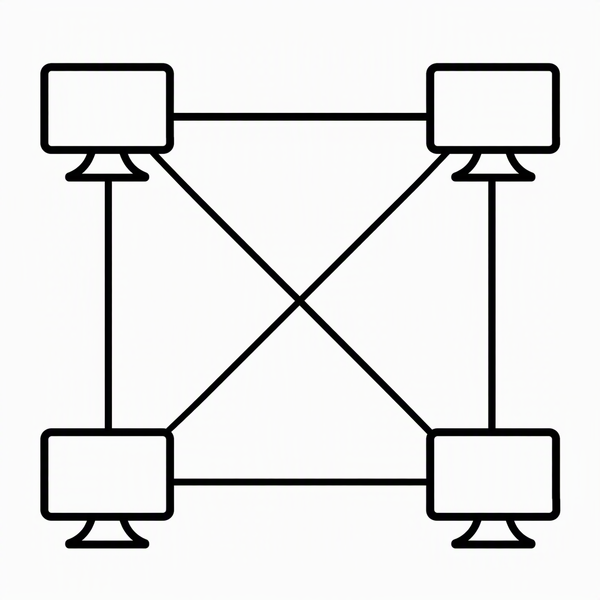
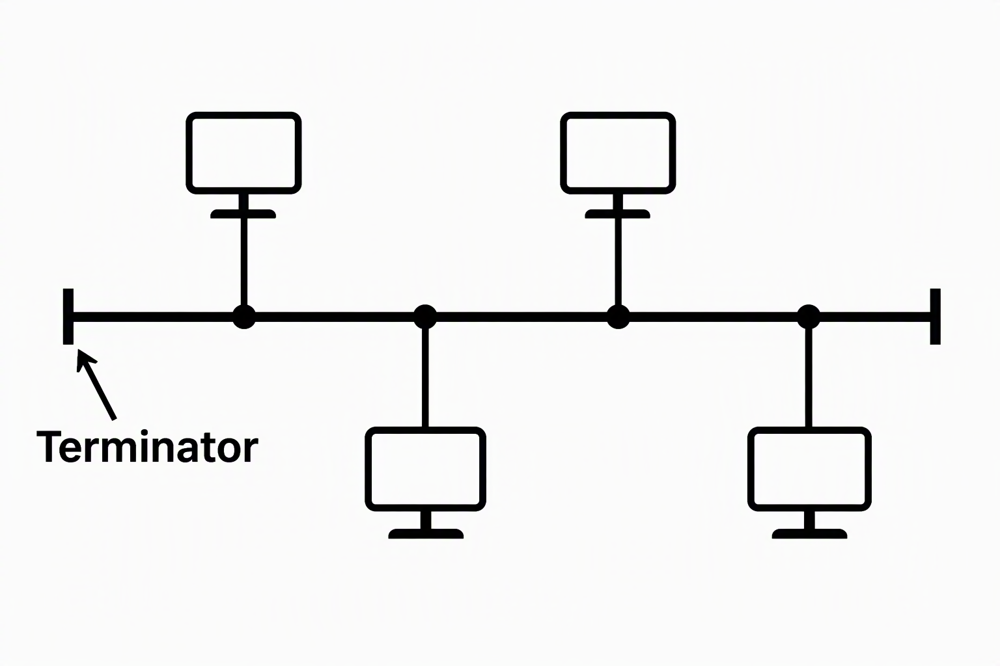
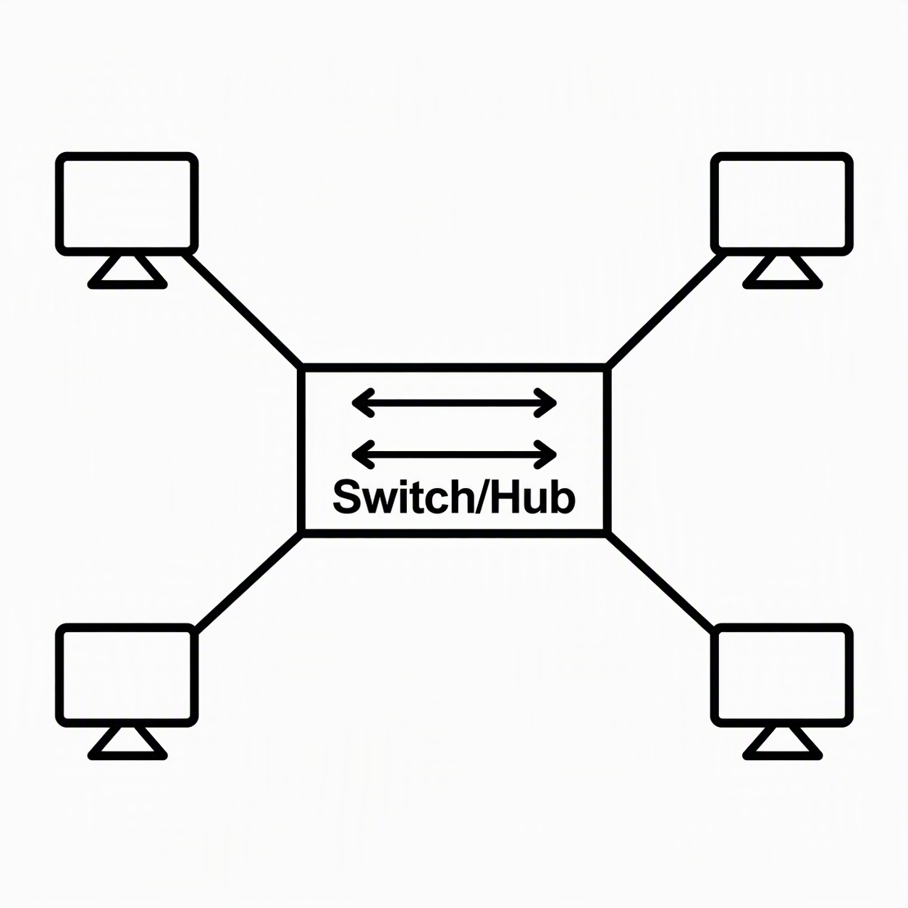
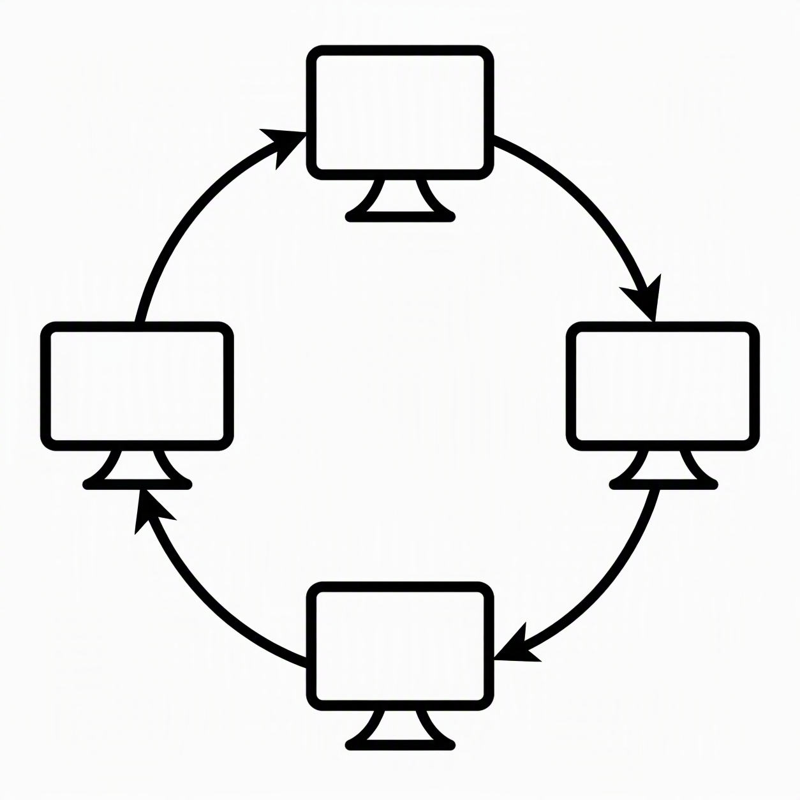

### 1. What is Network Topology?

Network Topology refers to the physical or logical arrangement of devices in a network and how they communicate with each other.

There are two types of network topologies:

**I. Physical Topology**

It refers to how the devices are physically arranged and connected to each other in a network.

**II. Logical Topology**

It refers to how data actually travels from one device to another in a network, regardless of their physical arrangement.

For now, we will mainly focus on Physical Topology.

### 2. Types of Physical Topologies

There are four major types of physical topologies:

I. Mesh Topology

II. Bus Topology

III. Star Topology

IV. Ring Topology

### 3. Mesh Topology

In Mesh Topology, every device is connected to every other device through a dedicated link.

**Advantages:**

- **High Redundancy:** Every device has multiple paths to communicate with other devices.
- **High Reliability:** If one or two links fail, data can travel through alternative paths to reach its destination.
- **Better Privacy:** Since devices communicate through dedicated links, there is less shared-medium exposure.

**Disadvantages:**

- **Complex Wiring:** Every device needs a dedicated connection to every other device.
- **High Cost:** It requires a large number of cables and network interfaces.

**Where is it used?**

Mesh topology is commonly used in WAN environments, particularly for connecting routers through dedicated links.

For example, when multiple routers are interconnected, if one link fails, data can travel through an alternative route.

**Important:** Mesh topology provides alternative paths, but it does not automatically guarantee packet security or encryption.

### 4. Bus Topology

In Bus Topology, all the devices are connected to a single central cable called the Backbone Cable or Trunk Cable.

Devices are connected to the backbone cable using connectors such as T-connectors.

**Advantages:**

- **Less Cabling:** It requires less cable compared to mesh topology.
- **Low Cost:** It does not require specialized networking devices like hubs or switches.
- **Simple Installation:** It is relatively easy to install for small networks.

**Disadvantages:**

- **Low Security:** Data travels through the shared communication medium, so other connected devices can potentially observe the transmitted data.
- **Single Point of Failure:** If the backbone cable breaks, the entire network can become non-functional.
- **Difficult Troubleshooting:** Identifying cable faults can be difficult.

**Adding New Devices:**

When a new device is connected to a traditional bus network, the backbone connection may need to be interrupted temporarily, affecting network communication.

### 5. Star Topology

Star Topology is the most widely used physical topology in modern LAN networks.

In Star Topology, all devices are connected to a centralized networking device, which can be a Switch or Hub.

Each device requires a separate cable to connect to the centralized networking device.

**Advantages:**

- **Easy Troubleshooting:** If a device is unable to communicate, we can check its individual link to the central device.
- **High Reliability:** If the communication link between one device and the central device breaks, only that particular device gets affected. Other devices remain unaffected.
- **Easy Expansion:** We can easily add new devices by connecting them to the centralized networking device.
- **Less Network Disruption:** Adding a new device generally does not require shutting down the entire network.

**Example:**

Let's say Device A wants to communicate with Device X.

If A sends data but X is unable to receive it, we can troubleshoot the individual links:

- Device A to the central device.
- Central device to Device X.

This makes troubleshooting easier.

**Adding New Devices:**

In Bus Topology, adding a new device may temporarily interrupt network communication.

However, in Star Topology, we can connect a new device directly to the switch without bringing down the entire network.

### 6. Ring Topology

In Ring Topology, all devices are connected in a circular manner, forming a closed loop.

Data travels from one device to another in a circular direction until it reaches its destination.

**Token-Based Ring Topology:**

To avoid collisions, Token Passing is used in traditional token-ring networks.

- A special frame called a Token circulates around the network.
- A device must possess the token to transmit data.
- Only the device holding the token can transmit data.
- After transmission, the token is passed to the next device.

This mechanism prevents multiple devices from transmitting simultaneously, thereby avoiding collisions.

**Advantages:**

- Avoids collisions through token passing.
- Provides controlled access to the communication medium.
- Every device gets an opportunity to transmit data.

**Disadvantages:**

- Failure of a device or link can disrupt a traditional single-ring network.
- Adding or removing devices can interrupt network communication.
- Troubleshooting can be difficult.

### 7. Quick Comparison of Physical Topologies

| Feature | Mesh | Bus | Star | Ring |
|---|---|---|---|---|
| Structure | Every device interconnected | Single backbone | Centralized device | Circular |
| Cabling | Very high | Low | Moderate | Moderate |
| Reliability | High | Low | High | Depends on ring design |
| Troubleshooting | Complex | Difficult | Easy | Difficult |
| Expansion | Difficult | Difficult | Easy | Difficult |
| Central device | No | No | Yes | No (traditional ring) |

### 8. Important CCNA Points

- **Mesh:** Every device is connected to every other device through dedicated links.
- **Bus:** All devices share a common backbone cable.
- **Star:** All devices connect to a centralized switch or hub.
- **Ring:** Devices are connected in a circular fashion.
- **Token Passing:** A device must have a token to transmit data in traditional Token Ring networks.

   ---

## 9. References

**Video:** Network Topology-Mesh,Bus,Ring,Star,hybrid and Tree Topology

**Channel:** Technical Guftugu

**Link:** https://youtu.be/ud4akHNdLDI?si=tg0QiqG3DjgjKbRG
