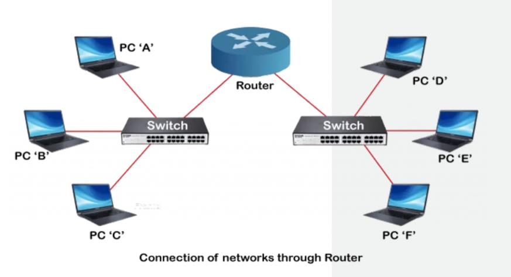
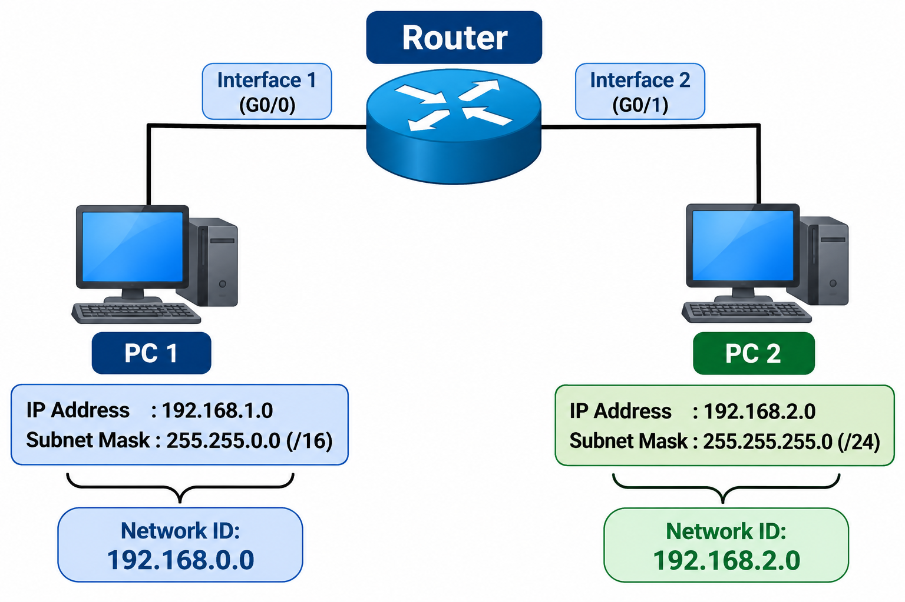

# ARP (Address Resolution Protocol)

## A. Introduction to ARP

In order to communicate with another device in a network, we need two types of addresses:

1. **IP Address (Logical Address):** Used to identify a device at the Network Layer (Layer 3).
2. **MAC Address (Physical Address):** Used to identify a device at the Data Link Layer (Layer 2).

### 1. Types of ARP Messages

There are two basic ARP messages:

1. **ARP Request**
   - When a device doesn't know the MAC address of the destination device, it generates an ARP request.
   - An ARP request is always a broadcast request.
   - Its destination MAC address is `FF:FF:FF:FF:FF:FF`.

2. **ARP Reply**
   - The device whose IP address matches the target IP address responds with its MAC address.
   - An ARP reply is generally a unicast response.
   - It is sent directly to the device that generated the ARP request.

### 2. Same Network Requirement

ARP requests are used to resolve MAC addresses within the local network.

**Important Rule:**

If the sender determines that the destination device belongs to a different IP network, it will not generate an ARP request for the destination device's MAC address.

Instead:

1. If the destination belongs to the same network:
   - The sender generates an ARP request for the destination device's MAC address, if it is not already available in its ARP cache.

2. If the destination belongs to another network:
   - The sender generates an ARP request for the default gateway's MAC address, if it is not already available in its ARP cache.

### 3. Example

Consider a router with two interfaces:

1. Port 1 is connected to Switch 1.
2. Port 2 is connected to Switch 2.
3. Multiple devices are connected to both switches.

Port 1 can communicate using ARP with devices connected to Switch 1, but it cannot directly broadcast an ARP request to devices connected to Switch 2.

**Why?**

Because routers separate Layer 2 broadcast domains and do not forward ARP broadcasts from one interface to another.

---

## B. ARP Packet Format

An ARP packet consists of eight fields.

### 1. Hardware Type (HTYPE)

It indicates the type of communication network or hardware being used.

For example:

i. Ethernet
ii. Other supported link-layer technologies

For Ethernet, its value is `1`.

### 2. Protocol Type (PTYPE)

It indicates which network-layer protocol is being used.

Since ARP is being used for IPv4 address resolution, its value is:

`0x0800 (IPv4)`

### 3. Hardware Length (HLEN)

It specifies the length of the hardware address (MAC address).

For Ethernet:

i. A MAC address is 48 bits or 6 bytes.
ii. Therefore, `HLEN = 6 bytes`.

### 4. Protocol Length (PLEN)

It specifies the length of the protocol address (IP address).

Since we are using IPv4:

i. Its length is 32 bits or 4 bytes.
ii. Therefore, `PLEN = 4 bytes`.

### 5. Operation (OPER)

It indicates whether the ARP packet is a request or a reply.

| Operation Value | Meaning |
|---|---|
| 1 | ARP Request |
| 2 | ARP Reply |

### 6. Sender Hardware Address (SHA)

It contains the MAC address of the device generating the ARP request or reply.

### 7. Sender Protocol Address (SPA)

It contains the IP address of the device generating the ARP request or reply.

### 8. Target Hardware Address (THA)

It contains the MAC address of the target device.

i. In an ARP request, the target MAC address is unknown, so it is set to `00:00:00:00:00:00`.
ii. In an ARP reply, it contains the actual MAC address of the receiver.

### 9. Target Protocol Address (TPA)

It contains the IP address of the target device.

**Note:** The packet has eight fields; the sender and target addresses each have two separate fields.

### 10. Difference between ARP Request and ARP Reply

| Field | ARP Request | ARP Reply |
|---|---|---|
| Operation | 1 | 2 |
| Sender MAC | Requester's MAC | Replier's MAC |
| Sender IP | Requester's IP | Replier's IP |
| Target MAC | All zeros | Actual receiver MAC |
| Target IP | Destination IP | Requester's IP |

---

## C. How ARP Works – Communication Between Different Networks

Let's understand how ARP works when two devices belong to different networks.

Consider the following network:

1. Router has two interfaces: Port 1 and Port 2.
2. Switch 1 is connected to Port 1.
3. Switch 2 is connected to Port 2.
4. Devices A, B, C and D are connected to Switch 1.
5. Devices E, F, G and H are connected to Switch 2.

Now, Device A wants to communicate with Device H.

### 1. Device A generates an IP packet

Device A creates an IP packet with:

i. Source IP Address = IP address of Device A.
ii. Destination IP Address = IP address of Device H.

Since Device H belongs to another network, Device A needs to send the packet to its default gateway.

### 2. Device A prepares an Ethernet frame

The Ethernet frame contains:

i. Source MAC Address = MAC address of Device A.
ii. Destination MAC Address = MAC address of Router's Port 1.

But how does Device A know the MAC address of Port 1?

It checks its ARP table. If the entry is not available, it generates an ARP request to find the default gateway's MAC address.

### 3. Switch 1 forwards the frame to the router

Switch 1 receives the frame and forwards it to the router's Port 1.

### 4. Router checks the destination IP address

The router examines the destination IP address of the incoming IP packet.

It checks its routing table and identifies that the destination network is reachable through Port 2.

### 5. Router checks its ARP table

Before forwarding the packet, the router needs the MAC address of Device H.

It checks its ARP table.

i. If the MAC address is available, it uses that entry.
ii. If the MAC address is unavailable, it generates an ARP request through Port 2.

This ARP request is broadcast within the network connected to Port 2.

### 6. Device H generates an ARP reply

Device H receives the ARP request and recognizes its IP address.

It sends an ARP reply containing its MAC address to the router's Port 2.

The router updates its ARP table with Device H's IP-to-MAC mapping.

### 7. Router forwards the packet to Device H

The router creates a new Ethernet frame.

i. Source MAC Address = MAC address of Router's Port 2.
ii. Destination MAC Address = MAC address of Device H.
iii. Source IP Address = IP address of Device A.
iv. Destination IP Address = IP address of Device H.

The router forwards this new frame through Switch 2, and it eventually reaches Device H.

### 8. Important Concept

Whenever a packet travels through a router, the source and destination MAC addresses are updated for the next network.

However, the original source and destination IP addresses generally remain unchanged.

This is how ARP helps devices communicate across different networks.

---

## D. Types of ARP

There are four commonly discussed types of ARP:

1. Normal ARP
2. Reverse ARP (RARP)
3. Proxy ARP
4. Gratuitous ARP

### 1. Normal ARP

Normal ARP is used to find the MAC address of a device when its IP address is already known.

In simple words:

**IP Address → MAC Address**

For example:

Device A knows the IP address of Device B but doesn't know its MAC address.

Device A generates an ARP request, and Device B responds with its MAC address.

This is called normal ARP.

### 2. Reverse ARP (RARP)

RARP stands for **Reverse Address Resolution Protocol**.

It is a Layer 3 protocol.

Unlike normal ARP, which resolves an IP address into a MAC address, RARP works in the opposite direction.

**MAC Address → IP Address**

#### i. Why do we need RARP?

Consider a situation where a computer knows its own MAC address but doesn't know its IP address.

This was particularly useful in older diskless workstations, which needed to obtain an IP address when starting up.

#### ii. How RARP works

1. A device knows its own MAC address but doesn't know its IP address.
2. It generates a RARP request containing its MAC address.
3. The request is broadcast over the local network.
4. A RARP server receives the request.
5. The server checks its mapping table to find the IP address associated with that MAC address.
6. The server sends a RARP reply containing the corresponding IP address.
7. The requesting device receives its IP address.

#### iii. Limitations of RARP

1. A RARP server is required on the local network.
2. It only provides the IP address and doesn't provide other configuration information such as subnet mask, default gateway or DNS.
3. It has largely become obsolete.

**Modern alternative:** DHCP (Dynamic Host Configuration Protocol) is used today to dynamically provide IP addresses and other network configuration information.

### 3. Proxy ARP

Proxy ARP is a technique in which a router responds to an ARP request on behalf of another device.

In simple words, the router acts as a proxy for the destination device and provides its own MAC address instead of the actual destination device's MAC address.

#### i. Why do we need Proxy ARP?

Let's understand with an example.

Consider two devices:

**PC1**

- IP Address: `192.168.1.10`
- Subnet Mask: `/16 (255.255.0.0)`

**PC2**

- IP Address: `192.168.2.20`
- Subnet Mask: `/24 (255.255.255.0)`

Both devices are connected to different interfaces of a router.

Let's calculate their network IDs.

**For PC1:**

`192.168.1.10/16`

Network ID = `192.168.0.0/16`

**For PC2:**

`192.168.2.20/24`

Network ID = `192.168.2.0/24`

Therefore, both devices actually belong to different IP networks.

#### ii. How does the problem occur?

**Important concept: ARP does not understand subnet masks.**

The ARP table does not contain a subnet mask column because ARP only maintains IP-to-MAC address mappings.

Therefore, ARP itself does not calculate or determine the network ID of a destination device.

The sender's IP layer performs the subnet calculation using its own subnet mask.

Let's understand this with our example.

**Step 1: PC1 calculates its own network ID**

PC1 has:

- IP Address = `192.168.1.10`
- Subnet Mask = `/16`

It calculates:

`192.168.1.10 AND 255.255.0.0`

Network ID = `192.168.0.0`

**Step 2: PC1 calculates the destination's network ID**

PC1 wants to communicate with PC2.

PC2's IP address is `192.168.2.20`.

PC1 does not know PC2's subnet mask. It only knows its own subnet mask.

Therefore, PC1 uses its own `/16` subnet mask to calculate the network ID of the destination IP address.

It calculates:

`192.168.2.20 AND 255.255.0.0`

Result = `192.168.0.0`

Since PC1's own network ID and the calculated destination network ID are the same, PC1 assumes that PC2 belongs to the same network.

However, PC2 actually belongs to:

`192.168.2.0/24`

Therefore, both devices belong to different IP networks, but PC1 incorrectly assumes that they are on the same network.

**Remember:** ARP itself does not perform this calculation. The sender uses its own subnet mask before deciding whether to send an ARP request.

#### iii. How does Proxy ARP work?

**Step 1: PC1 generates an ARP request**

Since PC1 believes PC2 belongs to the same network, it generates an ARP request.

The request contains:

- Sender IP = `192.168.1.10`
- Sender MAC = MAC address of PC1
- Target IP = `192.168.2.20`
- Target MAC = `00:00:00:00:00:00`

The request is broadcast over the local network.

**Step 2: Router receives the ARP request**

The router's interface connected to PC1 receives the broadcast ARP request.

Normally, routers do not forward ARP broadcasts to other interfaces.

However, if Proxy ARP is enabled, the router checks whether it can reach the requested destination IP address through another interface.

It checks its routing table.

The router finds that `192.168.2.20` is reachable through its other interface.

**Step 3: Router sends a Proxy ARP reply**

Now the router responds to PC1 on behalf of PC2.

But here's the important part:

The router sends its own interface MAC address (the interface connected to PC1) instead of PC2's actual MAC address.

PC1 receives the ARP reply and updates its ARP table.

It now believes that the MAC address associated with PC2's IP address is the router's MAC address.

**Step 4: PC1 sends the data to the router**

PC1 creates an Ethernet frame:

- Source MAC = MAC address of PC1.
- Destination MAC = MAC address of the router's interface connected to PC1.
- Source IP = `192.168.1.10`
- Destination IP = `192.168.2.20`

PC1 sends the frame to the router.

**Step 5: Router forwards the packet to PC2**

The router receives the frame, examines the destination IP address and forwards the IP packet through its other interface.

If it doesn't know PC2's MAC address, it generates a normal ARP request on that network.

After receiving the MAC address of PC2, it creates a new Ethernet frame and forwards the packet to PC2.

This is how Proxy ARP works.

#### iv. What happens if Proxy ARP is disabled?

If Proxy ARP is disabled:

1. PC1 generates an ARP request for PC2.
2. The router receives the broadcast request.
3. The router does not respond on behalf of PC2.
4. The router does not forward the broadcast to its other interface.
5. PC1 does not receive an ARP reply.
6. Therefore, PC1 cannot create the Ethernet frame required to send the packet.

#### v. Why doesn't the router simply forward the ARP request?

Because ARP requests are Layer 2 broadcasts, and routers do not forward Layer 2 broadcasts between different interfaces.

Proxy ARP provides an alternative mechanism.

Instead of forwarding the broadcast, the router responds to the original request with its own MAC address.

#### vi. Important points about Proxy ARP

1. It is generally used when devices incorrectly believe that a destination belongs to their local network.
2. It allows communication between devices belonging to different IP networks without requiring the sender to know that the destination is on another network.
3. The ARP table does not contain a subnet mask column.
4. ARP does not understand subnet masks or calculate network IDs.
5. The sender uses its own subnet mask to calculate the network ID of the destination IP address.
6. Proxy ARP must be enabled on the relevant router interface.
7. The router must have a valid route to the destination.
8. It can create unnecessary traffic and hide network misconfiguration, so it should be used carefully.

### 4. Gratuitous ARP (GARP)

Gratuitous ARP is used to announce or check the IP address of a device within the local network.

One of its important uses is **Duplicate IP Address Detection**.

It helps identify whether two or more devices have been assigned the same IP address.

#### i. Why do we need Gratuitous ARP?

Consider a network containing a switch connected to six devices:

A, B, C, D, E and F.

Suppose:

- Device A has IP address `10.0.0.1`.
- Device B also has IP address `10.0.0.1`.

Both devices have been assigned the same IP address.

This creates an IP address conflict.

As a result, network communication may become unreliable because the same IP address is associated with two different MAC addresses.

#### ii. How does Gratuitous ARP work?

**Step 1: Device A generates a Gratuitous ARP request**

Device A generates a special ARP request to check whether another device is already using its IP address.

In this request:

- Sender IP Address = `10.0.0.1`
- Target IP Address = `10.0.0.1`
- Sender MAC Address = MAC address of Device A
- Target MAC Address = `00:00:00:00:00:00`

The Ethernet destination MAC address is the broadcast address:

`FF:FF:FF:FF:FF:FF`

Notice that the sender IP and target IP are the same.

**Step 2: Switch broadcasts the request**

The switch forwards the broadcast ARP request to all devices in the same broadcast domain, except the incoming port.

Devices C, D, E and F receive the request.

They check the target IP address.

Since the IP address doesn't belong to them, they do not respond.

**Step 3: Device B recognizes the IP address**

Device B also receives the request.

It checks the target IP address and finds that `10.0.0.1` is already its own IP address.

It recognizes a possible IP address conflict.

Device B can respond with an ARP reply containing its MAC address.

**Step 4: Device A receives the reply**

Device A receives the ARP reply.

It realizes that another device is already using the same IP address.

Therefore, Device A can identify an IP address conflict and take appropriate action.

#### iii. What if Device A doesn't receive an ARP reply?

If Device A doesn't receive a response, it has no indication of another device using that IP address.

However, this does not guarantee that the IP address is unused. For example, another device might be offline or might not respond.

#### iv. Important characteristics of Gratuitous ARP

1. Sender IP and target IP are the same.
2. It is broadcast over the local network.
3. It can be used for duplicate IP address detection.
4. It can also update other devices' ARP caches when a device's MAC address changes.
5. It is commonly used during IP address assignment and in high-availability setups.

**Additional technical point:** There is a related mechanism called an ARP Probe. Before using a new IPv4 address, a device can send an ARP Probe with sender IP `0.0.0.0` and target IP set to the address it wants to use. This helps detect conflicts before the device starts using that address.

An ARP Announcement, on the other hand, announces an address that the device is already using.

---

## E. Quick Revision – Four Types of ARP

| Type | Purpose | Address Resolution |
|---|---|---|
| Normal ARP | Finds MAC address | IP → MAC |
| Reverse ARP (RARP) | Finds IP address | MAC → IP |
| Proxy ARP | Router responds on behalf of another device | Provides router's MAC |
| Gratuitous ARP | Detects duplicate IPs and announces IP-to-MAC mapping | Same source and target IP |

---

## F. Important Points to Remember

1. ARP is used in IPv4 networks.
2. ARP resolves an IPv4 address into a MAC address.
3. ARP requests are broadcast, whereas ARP replies are generally unicast.
4. ARP requests are not forwarded by routers.
5. ARP is generally classified as a Layer 2 protocol.
6. An Ethernet MAC address is 6 bytes, whereas an IPv4 address is 4 bytes.
7. ARP Request opcode = `1`.
8. ARP Reply opcode = `2`.
9. In an ARP request, the target hardware address is initially all zeros.
10. If the destination belongs to another network, the sender does not ARP for the remote destination's MAC address. It ARPs for the default gateway's MAC address.
11. Proxy ARP allows a router to respond to ARP requests on behalf of another device.
12. ARP does not understand subnet masks or calculate network IDs.
13. The sender uses its own subnet mask to determine the network ID of the destination IP address.
14. RARP was historically used to obtain an IP address using a MAC address. DHCP replaced it in modern networks.
15. Gratuitous ARP is useful for detecting duplicate IP addresses and announcing IP-to-MAC mappings.
16. IP addresses generally remain unchanged across routed hops, but MAC addresses change at every router hop.