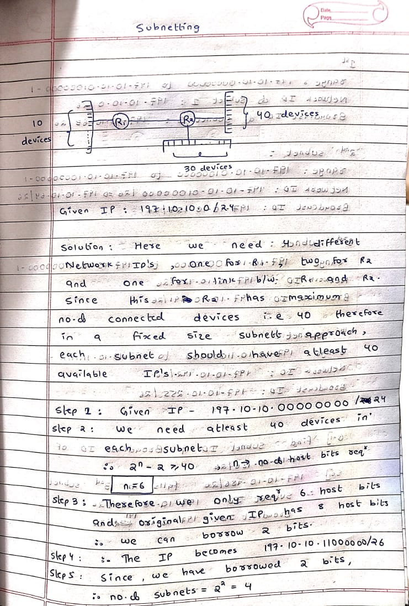
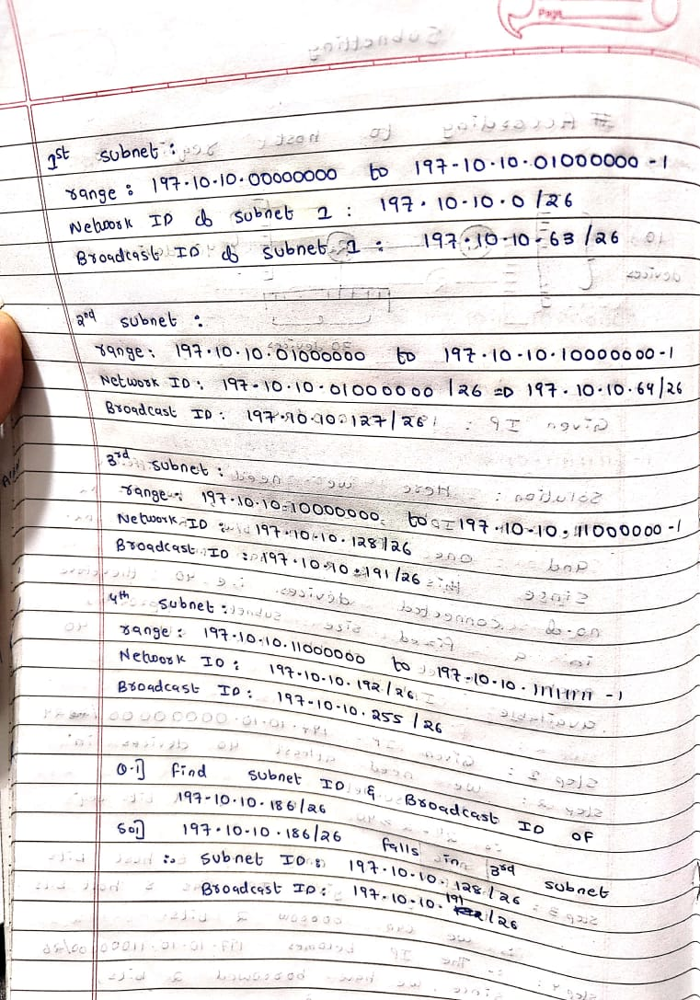
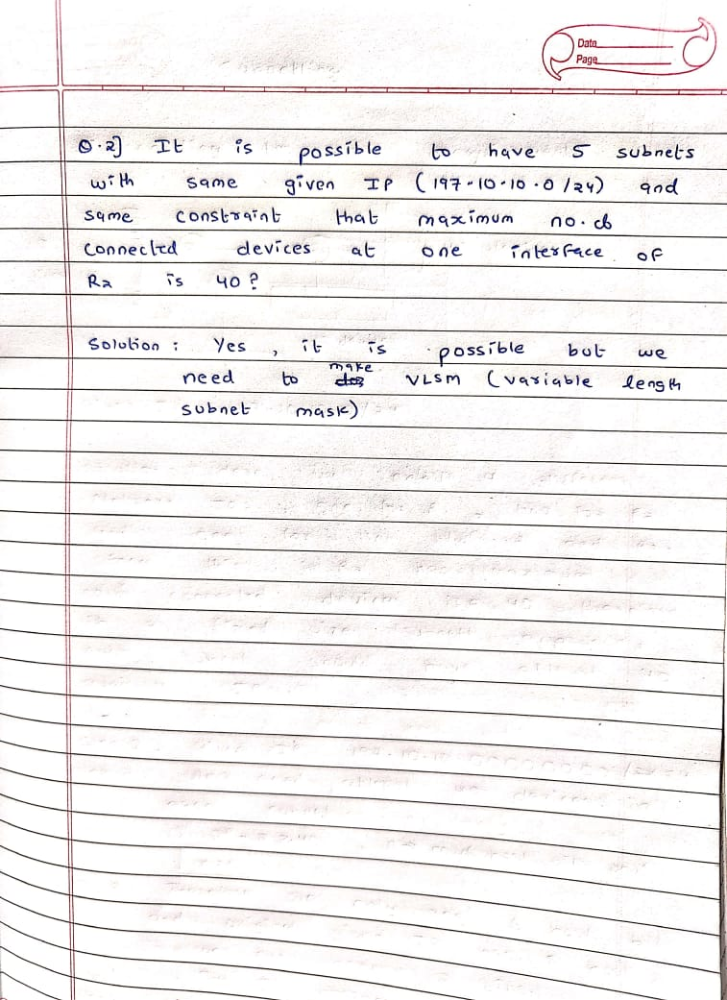
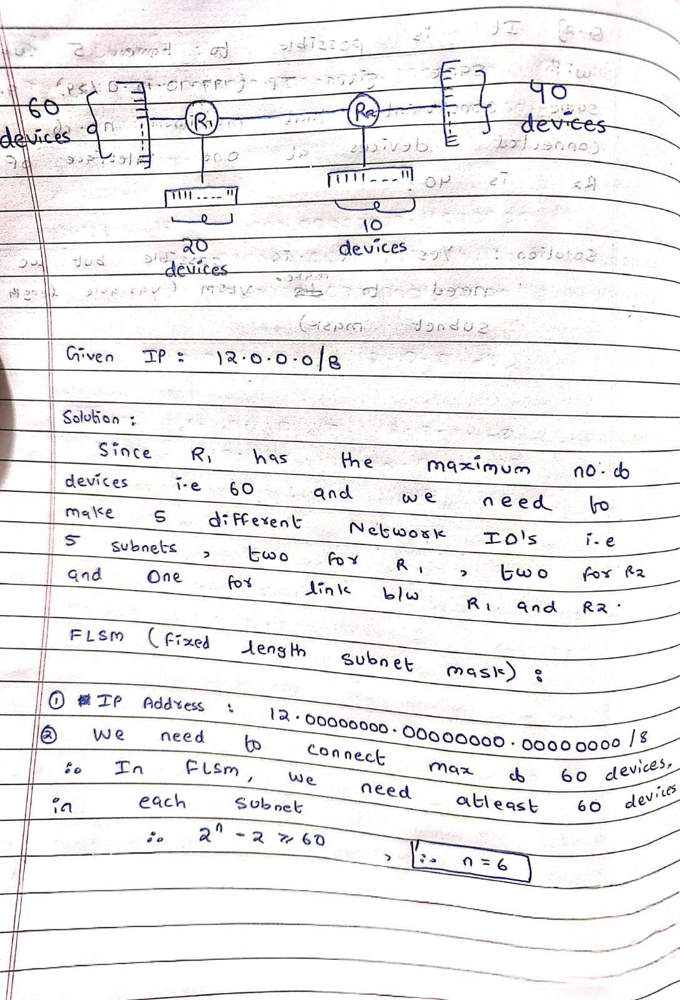
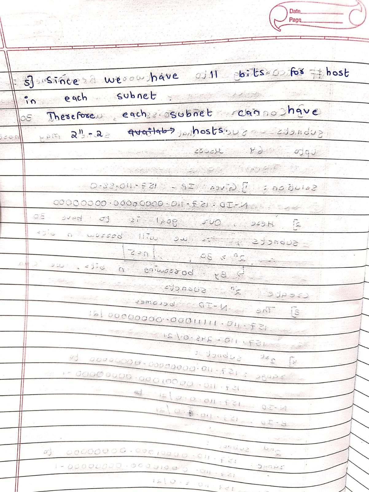
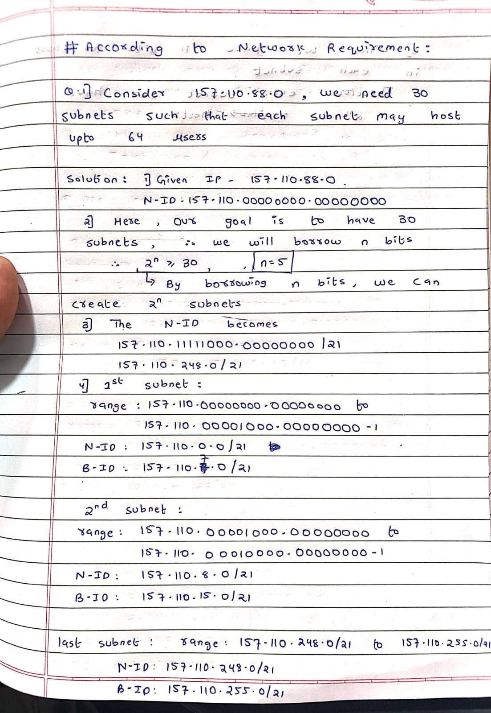
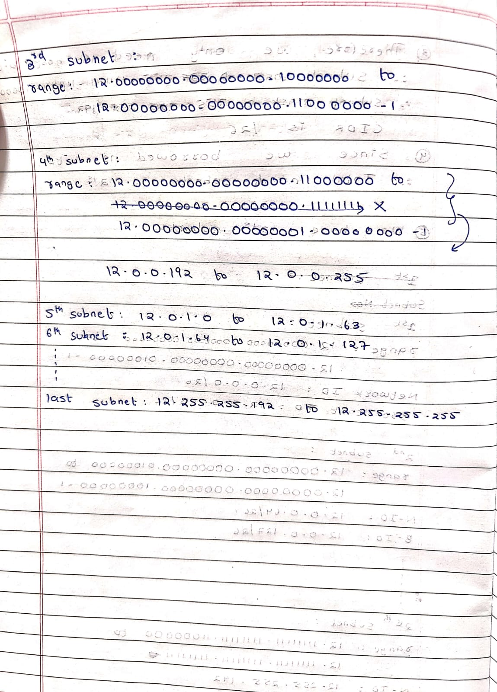

# 1. Introduction to Subnetting

**Definition:**

Subnetting is the logical division of a large network into smaller networks called subnets.

In subnetting, we divide a single IP network into multiple smaller networks by borrowing bits from the host portion of an IP address and assigning them to the network portion.

Each subnet has its own:
- Network ID
- Broadcast IP Address
- Range of usable host IP addresses
- Subnet Mask

**Why do we use Subnetting?**

The primary purpose of subnetting is to utilize IP addresses efficiently and reduce IP address wastage.

# 2. Why Do We Need Subnetting?

Let's understand this with an example.

Consider a network with a router having two interfaces:

- Interface 1: Connected to a switch with 10 devices.
- Interface 2: Connected to a switch with 50 devices.

Suppose we assign a Class A IP network to Interface 1 and a Class B IP network to Interface 2.

**Problem 1: Class A IP Address**

A default Class A network has:
- Network bits = 8
- Host bits = 24

Total available host addresses:

2²⁴ − 2 = 16,777,214 usable host IPs.

However, we are using only 10 devices.

Therefore, a huge number of IP addresses remain unused.

**Problem 2: Class B IP Address**

A default Class B network has:
- Network bits = 16
- Host bits = 16

Total available host addresses:

2¹⁶ − 2 = 65,534 usable host IPs.

However, we are using only 50 devices.

Again, thousands of IP addresses remain unused.

**Solution: Subnetting**

To prevent this wastage, we use subnetting.

Instead of assigning a very large network to a small group of devices, we divide a large network into smaller networks according to our requirements.

For example:
- One subnet can accommodate 10 devices.
- Another subnet can accommodate 50 devices.

This helps us utilize IP addresses more efficiently.

**Important:** Each router interface connecting to a different IP network must belong to a different IP subnet. Devices within the same LAN can generally share the same subnet.

# 3. Structure of an IPv4 Address

An IPv4 address consists of 32 bits, divided into four octets.

Example:

192.168.1.10

Each octet contains 8 bits.

An IPv4 address has two logical portions:

**1. Network Bits**

Network bits identify the network to which an IP address belongs.

**2. Host Bits**

Host bits identify individual devices within that network.

Example:

Consider a Class C network:

192.168.1.0/24

Here:
- Total IPv4 bits = 32
- Network bits = 24
- Host bits = 8

The /24 represents the CIDR prefix length, meaning the first 24 bits are reserved for the network portion.

# 4. Borrowing Bits in Subnetting

To create multiple subnets, we borrow some bits from the host portion and assign them to the network portion.

This process is called **Borrowing Bits**.

Suppose:
- Original network bits = N
- Original host bits = M
- Number of borrowed bits = X

After borrowing X bits:

New Network Bits = N + X

New Host Bits = M − X

**Example:**

Given a Class C network:

192.168.1.0/24

Original structure:
- Network bits = 24
- Host bits = 8

Suppose we borrow 2 bits from the host portion.

Now:

New Network Bits = 24 + 2 = 26

New Host Bits = 8 − 2 = 6

Therefore, the new subnet prefix becomes:

/26

The subnet mask becomes:

255.255.255.192

We can now create multiple smaller networks from the original /24 network.

# 5. Important Subnetting Formulas

There are two important calculations in subnetting.

**A. Number of Subnets**

Number of Subnets = 2ˣ

Where X = Number of Borrowed Bits.

**B. Number of Usable Hosts per Subnet**

Usable Hosts = 2ʰ − 2

Where h = Number of Remaining Host Bits.

We subtract 2 because:
- The first address represents the Network ID.
- The last address represents the Broadcast IP.

These two addresses cannot normally be assigned to individual devices.

**Example:**

Given a Class C network /24, suppose we borrow 2 bits.

Borrowed bits = 2

Remaining host bits = 8 − 2 = 6

Number of Subnets:

2² = 4 Subnets

Usable Hosts per Subnet:

2⁶ − 2 = 64 − 2 = 62 Hosts

Therefore, we get:
- 4 Subnets
- 62 Usable Host IPs per Subnet

# 6. Two Types of Subnetting Requirements

Subnetting problems generally involve two types of requirements.

## A. According to Host Requirement

In this approach, we calculate the number of host bits required according to the maximum number of devices that need to be connected to a particular network.

**Example:**

Suppose a user requires a network that can accommodate a maximum of 100 devices.

We use the formula:

2ʰ − 2 ≥ Required Hosts

Therefore:

2ʰ − 2 ≥ 100

If h = 6:

2⁶ − 2 = 62

62 is less than 100.

If h = 7:

2⁷ − 2 = 126

126 is greater than or equal to 100.

Therefore:

h = 7

We need 7 host bits to accommodate 100 devices.

Now consider that the original network is a Class C network /24.

Original host bits = 8

Required host bits = 7

Borrowed bits = 8 − 7 = 1

Therefore:

New Prefix = /24 + 1 = /25

Number of Subnets:

2¹ = 2 Subnets

Usable Hosts per Subnet:

2⁷ − 2 = 126 Hosts

Hence, by borrowing 1 bit, we can create 2 subnets, each supporting 126 usable host IP addresses.

## B. According to Network Requirement

In this approach, we calculate the number of bits to borrow according to the number of subnets or different networks required.

**Example:**

Suppose we have a Class C network:

192.168.1.0/24

The requirement is to create 12 different subnets.

We use:

Number of Subnets = 2ˣ

Where X = Borrowed Bits.

If we borrow 3 bits:

2³ = 8 Subnets

8 is less than 12.

If we borrow 4 bits:

2⁴ = 16 Subnets

16 is greater than or equal to 12.

Therefore:

X = 4 Borrowed Bits

New Prefix:

/24 + 4 = /28

Remaining Host Bits:

8 − 4 = 4

Usable Hosts per Subnet:

2⁴ − 2 = 14 Hosts

Therefore, we get:
- 16 Total Subnets
- 14 Usable Host IPs per Subnet

We can use 12 of these 16 subnets according to our requirement.

**Important:** In modern subnetting, we count all 2ˣ subnets. The old rule of excluding the first and last subnets is obsolete.

# 7. Subnet Mask and CIDR Notation

A subnet mask determines which bits of an IP address represent the network portion and which represent the host portion.

In a subnet mask:
- Network bits are represented by 1.
- Host bits are represented by 0.

Example:

/26

Binary Subnet Mask:

11111111.11111111.11111111.11000000

Decimal Subnet Mask:

255.255.255.192

Some important subnet masks:

| CIDR | Subnet Mask | Host Bits |
|---|---|---|
| /24 | 255.255.255.0 | 8 |
| /25 | 255.255.255.128 | 7 |
| /26 | 255.255.255.192 | 6 |
| /27 | 255.255.255.224 | 5 |
| /28 | 255.255.255.240 | 4 |
| /29 | 255.255.255.248 | 3 |
| /30 | 255.255.255.252 | 2 |

# 8. How to Calculate Subnet Ranges

After creating subnets, we need to calculate the following:

1. Network ID
2. First Usable Host IP
3. Last Usable Host IP
4. Broadcast IP

**Method:**

For a /24 network, the first three octets remain the same.

When borrowing bits in the fourth octet, the subnet ranges depend on the block size.

Block Size = 256 − Value of the Interesting Octet in the Subnet Mask.

For example, with /26:

Subnet Mask = 255.255.255.192

Block Size = 256 − 192 = 64

Therefore, the subnet network IDs increase by 64.

The subnet ranges will be:

- 0–63
- 64–127
- 128–191
- 192–255

For each subnet:
- First address = Network ID
- Last address = Broadcast IP
- Addresses between them = Usable Host IPs

**Binary Understanding:**

In /26, we borrow 2 bits from the original /24 host portion.

The last octet becomes:

NNHHHHHH

Here:
- NN = Borrowed network bits
- HHHHHH = Remaining host bits

The borrowed bits can have four combinations:

00, 01, 10, 11

Each combination represents a different subnet.

The remaining six host bits determine the addresses within each subnet.

---

# 9. Practical Example – Subnetting According to Host Requirement

Here, we are solving the question using FLSM (fixed length subnet mask)

Example 1:

Example 2:

Example 3:

---

# 10. FLSM – Fixed Length Subnet Mask

**Definition:**

FLSM (Fixed Length Subnet Mask) is a subnetting technique in which all the subnets created from a given network have the same subnet mask and the same number of available host IP addresses.

In FLSM, every subnet has an equal size, regardless of the actual number of devices connected to it.

# 11. VLSM – Variable Length Subnet Mask

**Definition:**

VLSM (Variable Length Subnet Mask) is a subnetting technique in which different subnets can have different subnet masks and different sizes according to their individual requirements.

In VLSM, we allocate IP addresses according to the number of devices required in each network.

---

**Conclusion:**

Subnetting helps us divide a large network into smaller networks by borrowing bits from the host portion.

FLSM creates equal-sized subnets, whereas VLSM creates different-sized subnets according to the host requirements of each network.