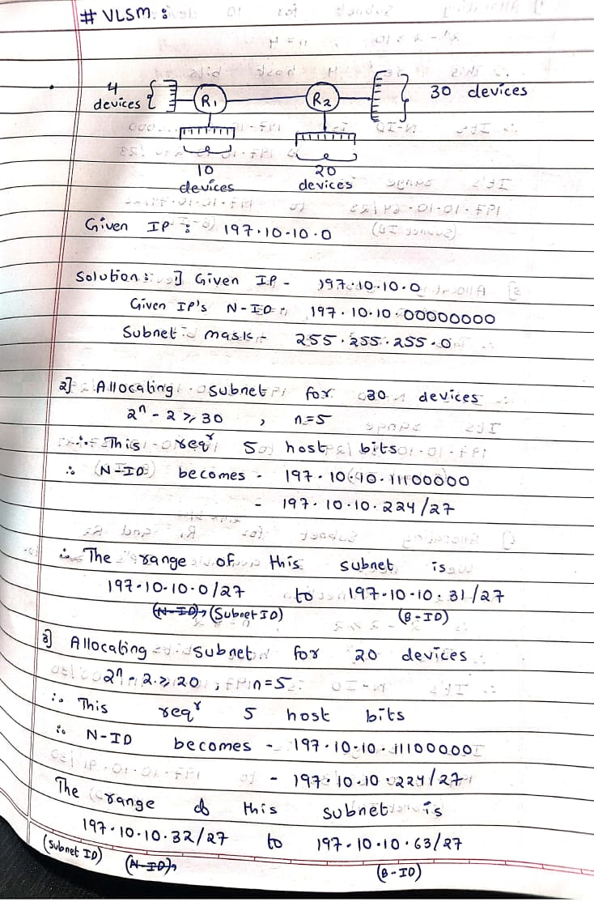
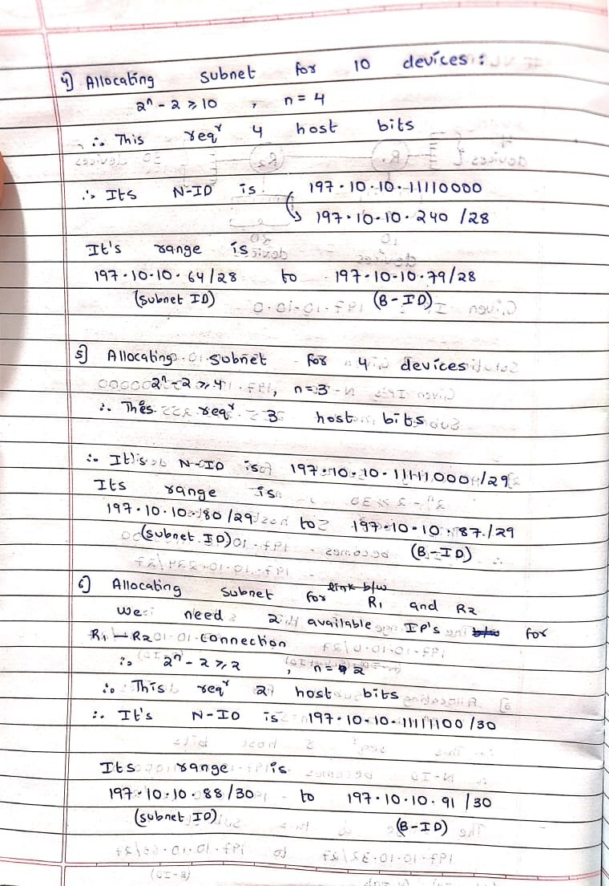

# VLSM (Variable Length Subnet Masking)

## 1. What is VLSM?

VLSM stands for **Variable Length Subnet Masking**.

VLSM is a subnetting technique in which we divide a larger network into multiple smaller networks (subnets), and each subnet is assigned a different subnet mask according to its host requirements.

In simple words, VLSM allows us to allocate different subnet sizes to different networks depending on the number of hosts required.

## 2. Why do we use VLSM?

VLSM is used to reduce IP address wastage and utilize the available IP address space efficiently.

### Example

Suppose an organization has three departments:

| Department | Required Hosts |
|---|---:|
| HR | 100 |
| Development | 50 |
| Management | 20 |

Now, each department has different host requirements.

- HR requires 100 hosts, so we need 7 host bits because \(2^7-2=126\) usable hosts.
- Development requires 50 hosts, so we need 6 host bits because \(2^6-2=62\) usable hosts.
- Management requires 20 hosts, so we need 5 host bits because \(2^5-2=30\) usable hosts.

Therefore, each department will receive a different subnet size according to its requirements.

## 3. Difference Between FLSM and VLSM

### A. FLSM (Fixed Length Subnet Masking)

In FLSM, all subnets have the same subnet mask and the same size, regardless of the number of hosts required.

For example, if HR requires 100 hosts and Management requires only 20 hosts, both departments will receive the same subnet size based on the largest requirement.

- HR gets 126 usable IP addresses.
- Management also gets 126 usable IP addresses.

This results in unnecessary IP address wastage.

### B. VLSM (Variable Length Subnet Masking)

In VLSM, different subnets can have different subnet masks and different sizes according to their host requirements.

- HR gets 126 usable IP addresses.
- Development gets 62 usable IP addresses.
- Management gets 30 usable IP addresses.

This reduces unnecessary IP address wastage.

## 4. How Does VLSM Work?

VLSM works by allocating different subnet masks to different subnets according to their host requirements.

For example, suppose we have the following network:

`192.168.1.0/24`

We need to divide it among three departments:

| Department | Hosts Required | Host Bits | Subnet Mask |
|---|---:|---:|---|
| HR | 100 | 7 | /25 |
| Development | 50 | 6 | /26 |
| Management | 20 | 5 | /27 |

Here:

- HR requires 7 host bits, which provide 126 usable IP addresses.
- Development requires 6 host bits, which provide 62 usable IP addresses.
- Management requires 5 host bits, which provide 30 usable IP addresses.

Therefore, every subnet will have a different subnet mask.

## 5. Different Subnet Sizes and IP Ranges

Using the above example, the network `192.168.1.0/24` can be divided as follows:

| Department | Network Range | Prefix | Total IPs |
|---|---|---|---:|
| HR | 192.168.1.0 – 127 | /25 | 128 |
| Development | 192.168.1.128 – 191 | /26 | 64 |
| Management | 192.168.1.192 – 223 | /27 | 32 |

The remaining address range is:

`192.168.1.224 – 192.168.1.255`

This address space can be used for future requirements.

**Important:** Each subnet has its own Network ID, Broadcast Address and usable host range.

## 6. Practical Example of VLSM

## 7. Properties of VLSM

### A. Different Subnet Masks

Different subnets can have different subnet masks.

### B. Different Subnet Sizes

Each subnet can have a different number of IP addresses according to its host requirements.

### C. Efficient IP Utilization

IP addresses are allocated according to actual requirements, reducing wastage.

### D. Classless Addressing

VLSM uses classless addressing and is not restricted to default Class A, B or C subnet masks.

### E. Hierarchical Subnetting

A larger network can be divided into smaller subnets, allowing better network organization.

### F. Proper IP Planning

Subnet ranges must be calculated carefully to avoid overlapping IP addresses.

## 8. Advantages of VLSM

### A. Reduces IP Address Wastage

Allocates IP addresses according to the actual host requirements of each subnet.

### B. Efficient IP Utilization

Makes better use of the available IP address space.

### C. Flexibility

Allows different departments or networks to have different subnet sizes.

### D. Scalability

Makes it easier to accommodate future network expansion when address space is available.

### E. Better Network Management

Helps organize large networks into smaller, manageable subnets.

## 9. Disadvantages of VLSM

### A. Complex Subnetting

Calculating different subnet masks and IP ranges can be more complicated than FLSM.

### B. Requires Proper Planning

Incorrect IP allocation can result in overlapping subnet ranges.

### C. Routing Protocol Support

Requires classless routing protocols that carry subnet mask information.

### D. Configuration Complexity

Managing different subnet masks across network devices can be more complicated.

### E. Troubleshooting

Different subnet sizes and routing configurations can make troubleshooting comparatively difficult.

## 10. Important Points to Remember

- VLSM = Variable Length Subnet Masking.
- VLSM allows different subnet masks within the same larger network.
- Each subnet gets IP addresses according to its host requirements.
- VLSM reduces IP address wastage.
- Different subnets can have different sizes.
- VLSM uses classless addressing.
- Classless routing protocols support VLSM.
- Generally, allocate the largest subnet first and then move towards smaller subnets.

### Important Formula

Usable Hosts = 2^h-2

Where `h` represents the number of host bits.

| Host Bits | Total IPs | Usable Hosts |
|---|---:|---:|
| 7 | 128 | 126 |
| 6 | 64 | 62 |
| 5 | 32 | 30 |
| 4 | 16 | 14 |
| 3 | 8 | 6 |

  ---

# 11. References

**Video:** VLSM/Variable length subnet Mask{subnetting Part-5}-Hindi/Urdu l how to do VLSM | Computer Networks

**Channel:** Technical Guftugu

**Link:** https://youtu.be/Y8rf9imNIRI?si=fAlSX81QfER-gIP9
