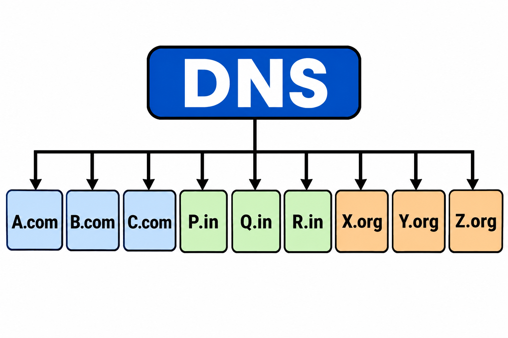
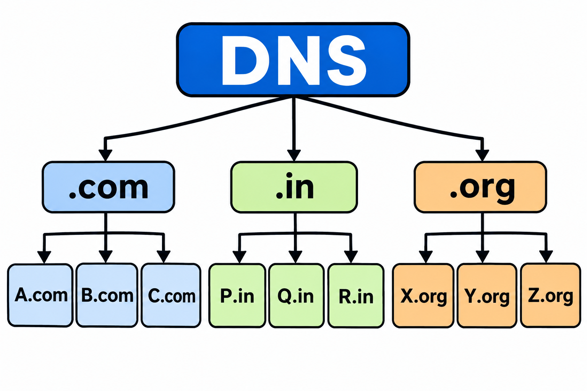
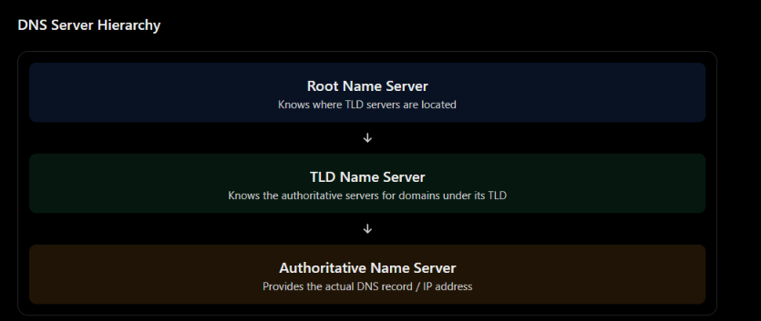
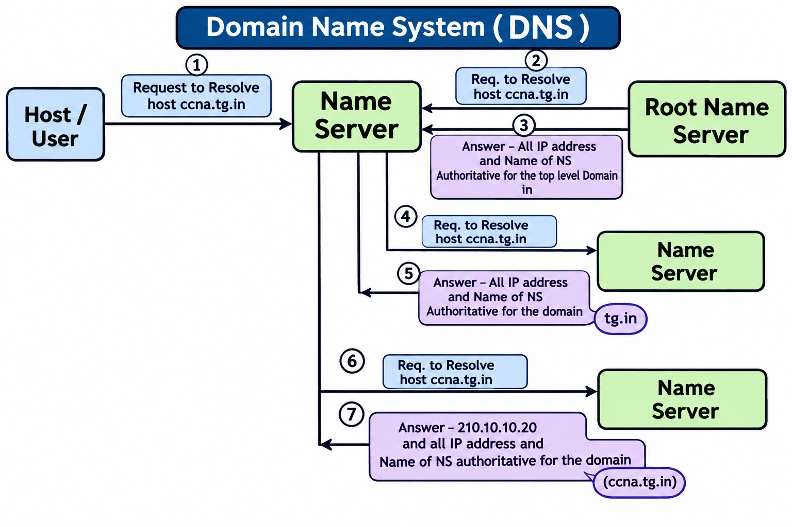
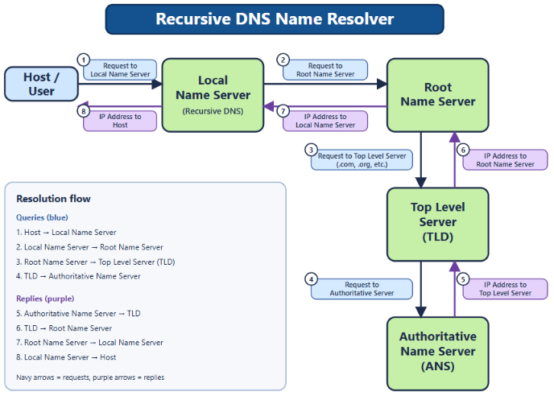

### DNS – Domain Name System

### 1. Introduction to DNS

- DNS stands for **Domain Name System**.
- DNS is used to translate domain names (hostnames) into their corresponding IP addresses and vice versa.
- Computers communicate using IP addresses, not human-readable domain names.
- DNS makes it easier for users to access websites using domain names instead of remembering IP addresses.

A domain name consists of different labels. For example:

`google.com`

- `google` – Second-Level Domain (SLD), this is the name
- `.com` – Top-Level Domain (TLD), this is the domain

**More examples:**

| Domain Name | Second-Level Domain | TLD |
|---|---|---|
| google.com | google | .com |
| facebook.com | facebook | .com |
| government.org | government | .org |
| example.in | example | .in |

**Note:** `.com`, `.org`, `.in`, etc. are Top-Level Domains (TLDs), not complete domain names by themselves.

**Example:**

Suppose a user wants to access:

`www.facebook.com`

Humans can easily remember this domain name, but computers need the corresponding IP address to establish communication.

DNS resolves the domain name into its corresponding IP address.

### Types of DNS Lookup

**I. Forward DNS Lookup:** Converts a domain name into its corresponding IP address.

**Example:**

`www.facebook.com → IP Address`

**II. Reverse DNS Lookup:** Converts an IP address into its corresponding domain name using a PTR record.

**Example:**

`IP Address → Domain Name`

### 2. Characteristics of DNS

- DNS works at the Application Layer of the OSI model.
- DNS primarily uses UDP port 53.
- DNS also uses TCP port 53 when required.
- DNS follows a hierarchical and distributed architecture.
- DNS supports caching to reduce lookup time and network traffic.
- DNS uses 13 named logical Root Server identities, from A to M.
- Protocol Number of DNS is 17

### 3. Top-Level Domains (TLDs)

A **Top-Level Domain (TLD)** is the last part of a domain name, appearing after the final dot.

For example, in `www.example.com`, `.com` is the TLD.

**Common examples:**

| TLD | Purpose |
|---|---|
| .com | Commercial websites |
| .org | Organizations |
| .net | Network-related organizations (originally) |
| .edu | Educational institutions |
| .gov | Government organizations |
| .mil | Military organizations |
| .in | India |
| .uk | United Kingdom |
| .us | United States |

### 4. Types of Domains

DNS domains are traditionally classified into three categories:

**I. Generic Domain**

- Generic domains represent different types of organizations or purposes.
- They are generally based on the nature or category of an organization.

**Examples:**

- .com
- .org
- .edu
- .net
- .biz
- .mil

**II. Country Domain**

- Country domains are assigned to individual countries.
- They are generally represented using two-letter country codes.

**Examples:**

- .in – India
- .uk – United Kingdom
- .us – United States
- .jp – Japan

**III. Inverse Domain**

- Inverse domain mapping is used to find the domain name associated with a given IP address.
- It is used in Reverse DNS Lookup.
- It uses PTR (Pointer) records.

**Example:** Finding the hostname associated with a particular IP address.

### 5. Namespace in DNS

Namespace refers to the way domain names are organized and structured within DNS.

There are two types of namespace structures:

**I. Flat Namespace**

- In a flat namespace, all names exist at the same level without a hierarchical structure.
- Every name is maintained within a single-level naming system.
- As the number of devices and names increases, managing and searching names becomes difficult.
- It is not suitable for large-scale distributed naming systems.

**II. Hierarchical Namespace**

- In a hierarchical namespace, domain names are organized in multiple levels.
- Each level can contain subdomains or branches.
- It makes domain management easier and more organized.
- It supports scalability and efficient name resolution.

**For example:**

- facebook.com
- wikipedia.org
- example.in

Each domain belongs to a particular branch of the DNS hierarchy.

### 6. Hierarchy of DNS Name Servers

DNS follows a hierarchical structure. Different types of DNS servers work together to resolve a domain name into its corresponding IP address.

There are three main types of DNS name servers:

**I. Root Name Server**

- The Root Name Server is at the top of the DNS hierarchy.
- There are 13 logical Root Server identities, named alphabetically from A to M.
- These root servers do not store the IP addresses of every website.
- Instead, they maintain information about Top-Level Domain (TLD) name servers.
- They direct DNS resolvers towards the appropriate TLD name server.

**Examples of TLDs:**

- .com
- .org
- .in
- .net

**II. Top-Level Domain (TLD) Name Server**

- TLD Name Servers are responsible for specific top-level domains.
- They maintain information about the authoritative name servers responsible for domains under their TLD.

**For example:**

- .com TLD server handles queries related to .com domains.
- .org TLD server handles queries related to .org domains.
- .in TLD server handles queries related to .in domains.

**Example:**

If a user wants to resolve `www.facebook.com`:

- The Root Name Server directs the resolver to the .com TLD Name Server.
- The .com TLD Name Server provides information about the authoritative name server for facebook.com.

**III. Authoritative Name Server**

- The Authoritative Name Server contains the actual DNS records for a particular domain.
- It provides the final DNS answer for the domain it is authoritative for.
- It stores records such as:

  A. **A Record** – Maps a domain name to an IPv4 address.

  B. **AAAA Record** – Maps a domain name to an IPv6 address.

  C. **MX Record** – Specifies mail servers.

  D. **CNAME Record** – Maps one domain name to another domain name.

  E. **PTR Record** – Used for reverse DNS lookup.

**Example:**

When the resolver reaches the authoritative name server for facebook.com, it can obtain the corresponding IP address from its DNS records.

**Important:** The Root and TLD Name Servers generally provide referrals to the next level. They do not normally resolve the complete domain name themselves.

### 7. DNS Caching

- DNS caching is a technique in which previously resolved DNS records are temporarily stored to reduce lookup time.
- When a user accesses a website, the DNS resolver checks whether the required DNS record is already available in its cache.
- If the record is available and has not expired, the resolver can return the cached answer without contacting the DNS hierarchy again.

### Working of DNS Cache

Suppose a user wants to access `www.example.com`.

**First Request:**

I. The user requests the IP address of www.example.com.

II. The local DNS resolver checks its cache.

III. If the record is not available, it performs DNS resolution by contacting the required DNS servers.

IV. The resolver receives the answer from the authoritative name server.

V. The resolver stores the DNS record in its cache according to its TTL.

**Subsequent Requests:**

I. Another user requests www.example.com.

II. The DNS resolver checks its cache.

III. If the cached record is still valid, it returns the IP address directly.

IV. There is no need to perform the complete DNS resolution again.

### DNS Cache Expiration (TTL)

- TTL stands for **Time To Live**.
- It specifies how long a DNS record can remain in a cache before it must be refreshed.
- Once the TTL expires, the cached record is no longer considered valid for answering a normal query.
- The resolver performs a fresh lookup when the record is requested again.

**Example:**

Suppose the TTL of a DNS record is 48 hours.

- At hour 0, the resolver obtains the IP address of www.example.com.
- The record is cached for 48 hours.
- During this period, subsequent requests can be answered from the cache.
- After 48 hours, the record expires.
- When the next request arrives, the resolver performs a fresh DNS lookup.

**Note:** TTL is not fixed at 48 hours. It is configured separately for DNS records and can vary from seconds to days.

### 8. DNS Name Resolution

DNS Name Resolution is the process of converting a domain name into its corresponding IP address.

When a user enters a website address in a browser, the system needs to resolve that domain name before establishing communication with the destination.

The two main types of DNS resolution are:

I. Iterative Name Resolution

II. Recursive Name Resolution

### 1. Iterative Name Resolution

In iterative resolution, each DNS server responds to the resolver with the best information it has, usually a referral to another DNS server.

The local DNS resolver is responsible for contacting the next DNS server.

**Example:**

Suppose a user wants to access:

`www.ccna.tg.in`

Assume the local DNS resolver does not have its IP address in its cache.

**Working:**

I. The Host/User sends a DNS query to the Local DNS Resolver.

II. The Local DNS Resolver contacts the Root Name Server.

III. The Root Name Server identifies the .in TLD and returns a referral to the .in TLD Name Server.

IV. The Local DNS Resolver contacts the .in TLD Name Server.

V. The .in TLD Name Server provides a referral to the authoritative server for tg.in.

VI. The Local DNS Resolver contacts the authoritative Name Server for tg.in.

VII. The authoritative Name Server returns the IP address of www.ccna.tg.in (if that record exists).

VIII. The Local DNS Resolver returns the IP address to the Host/User and caches the DNS record according to its TTL.

**Important:** In iterative resolution, the Local DNS Resolver contacts each server one by one. The Root and TLD servers generally provide referrals, not the final IP address.

### 2. Recursive Name Resolution

- In recursive resolution, the DNS client requests the complete answer from its DNS resolver.
- The client does not need to contact Root, TLD and Authoritative Name Servers individually.
- The Local DNS Resolver takes responsibility for obtaining the final answer.

**Working:**

I. The Host/User sends a recursive DNS query to the Local DNS Resolver.

II. The Local DNS Resolver performs the required DNS lookups.

III. It contacts the Root Name Server if necessary.

IV. It follows the referrals to the appropriate TLD Name Server.

V. It contacts the Authoritative Name Server.

VI. The Authoritative Name Server returns the requested DNS record.

VII. The Local DNS Resolver returns the final IP address to the Host/User.

VIII. The resolver caches the record according to its TTL.

**Important:** The recursive relationship is between the Host and its Local DNS Resolver. The Local DNS Resolver normally performs iterative queries to Root, TLD and Authoritative Name Servers.

### 9. DNS Protocols and Port Numbers

DNS uses two transport-layer protocols:

### UDP (User Datagram Protocol)

- DNS primarily uses UDP for normal queries and responses.
- UDP is connectionless and has low overhead.
- It is generally faster for DNS lookups because it does not require a connection establishment process.

**Port Number:** 53

### TCP (Transmission Control Protocol)

DNS also uses TCP when required.

**Common situations include:**

- Zone transfers between DNS servers.
- Responses that are too large for normal UDP handling or require TCP fallback.

**Port Number:** 53

| Protocol | Port Number | Usage |
|---|---:|---|
| UDP | 53 | Normal DNS queries and responses |
| TCP | 53 | Zone transfers and larger DNS responses |

**Remember:** DNS uses both TCP and UDP, but UDP is commonly used for regular DNS queries.

### 10. Important DNS Records

DNS stores different types of records to provide different kinds of information.

| Record | Purpose |
|---|---|
| A | Maps a domain name to an IPv4 address |
| AAAA | Maps a domain name to an IPv6 address |
| CNAME | Creates an alias for another domain name |
| MX | Specifies the mail server for a domain |
| NS | Specifies the authoritative name servers for a domain |
| PTR | Maps an IP address to a domain name (Reverse DNS) |

### 11. Quick Revision – DNS

| Concept | Important Point |
|---|---|
| Full Form | Domain Name System |
| OSI Layer | Application Layer |
| Primary Port | 53 |
| Transport Protocol | UDP and TCP |
| Forward Lookup | Domain Name → IP Address |
| Reverse Lookup | IP Address → Domain Name |
| Root Servers | 13 logical identities (A–M) |
| TLD Server | Handles .com, .org, .in, etc. |
| Authoritative Server | Provides actual DNS records |
| DNS Cache | Stores previously resolved records |
| TTL | Determines cache validity |
| Iterative Resolution | Resolver contacts DNS servers one by one |
| Recursive Resolution | Resolver obtains the complete answer for the client |
