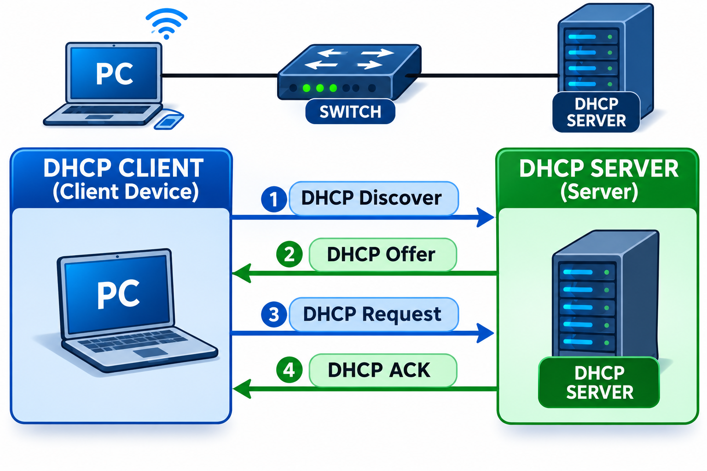
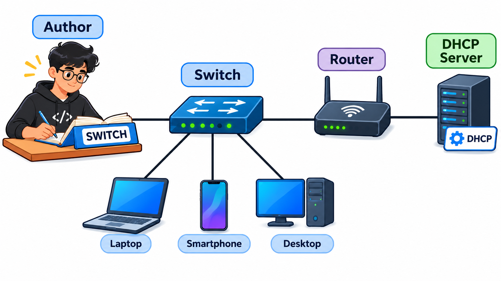

### DHCP (Dynamic Host Configuration Protocol)

### 1. What is DHCP?

DHCP stands for **Dynamic Host Configuration Protocol**.

DHCP is a network protocol that automatically assigns IP addresses and other network configuration parameters to devices (clients) in a network.

- Whenever a device connects to a network and requests an IP address, the DHCP server provides an IP address to that device.
- DHCP mostly provides Private IP addresses because it is generally used in Local Area Networks (LANs).
- However, DHCP can also assign Public IP addresses. For example, an ISP can use DHCP to assign a public IP address to a customer's router.

**Why do we need DHCP?**

We can manually configure IP addresses on computers. This is called **Static IP Configuration**.

But imagine a network having thousands of computers. Manually configuring and maintaining IP addresses for every computer becomes difficult and can also lead to configuration errors.

Therefore, we use a DHCP server to automatically assign IP addresses to clients.

### 2. How does DHCP work?

- DHCP works at the Application Layer of the TCP/IP model.
- It follows the Client-Server Architecture.

There are two main components:

I. **DHCP Client:** The device that requests an IP address from the DHCP server.

II. **DHCP Server:** The server that automatically assigns IP addresses to DHCP clients.

The DHCP server maintains a pool of available IP addresses and assigns them to clients whenever they request an IP address.

### 3. Dynamic IP Address Allocation

DHCP dynamically allocates IP addresses to clients for a specific period called a **Lease Time**.

**For example:**

- Suppose a DHCP server assigns 192.168.1.10 to my computer.
- The lease time is 15 minutes.
- Before the lease expires, my computer sends a DHCP Request to renew the IP address.
- If the DHCP server approves the renewal, my computer can continue using the same IP address.
- If the lease expires without renewal, the server can make that IP address available for another device.

**Note:** DHCP clients normally attempt to renew their leases automatically before they expire. They don't necessarily wait until the entire lease time is over.

### 4. DHCP Scope

A DHCP server administrator defines a range of IP addresses that the server can allocate to clients.

This range is called a **DHCP Scope**.

**For example:**

Suppose we configure a DHCP server with the following IP address range:

- Starting IP: 192.168.1.10
- Ending IP: 192.168.1.200

Now, whenever a device requests an IP address, the DHCP server can allocate an available IP address from this range.

This defined range is called a Scope.

**Important:** The DHCP server can only allocate valid and available host IP addresses from its configured scope. Network addresses, broadcast addresses and excluded addresses cannot be assigned to ordinary clients.

### 5. DHCP Lease Table

A DHCP server maintains a **DHCP Lease Table**.

It keeps track of which IP address has been assigned to which client.

**For example:**

| MAC Address | Assigned IP Address |
|---|---|
| AA:BB:CC:11:22:33 | 192.168.1.10 |
| AA:BB:CC:44:55:66 | 192.168.1.11 |
| AA:BB:CC:77:88:99 | 192.168.1.12 |

This helps the DHCP server maintain the mapping between client MAC addresses and their assigned IP addresses.

### 6. DHCP Port Numbers

DHCP uses UDP (User Datagram Protocol).

It uses two port numbers:

- **UDP Port 67** – DHCP Server
- **UDP Port 68** – DHCP Client

| Component | Port | Purpose |
|---|---:|---|
| DHCP Client | 68 | Sends requests |
| DHCP Server | 67 | Receives client requests |
| DHCP Server | 67 | Sends responses |
| DHCP Client | 68 | Receives server responses |

**In simple terms:**

- Client sends from port 68 to port 67.
- Server sends from port 67 to port 68.

### 7. What information does DHCP provide?

A DHCP server provides multiple network configuration parameters to its clients.

I. **IP Address:** Assigns an IP address to the client.

II. **Subnet Mask:** Defines which bits represent the network portion and which bits represent the host portion of an IP address.

III. **Domain Name:** Provides the domain name associated with the network.

IV. **Default Gateway:** Provides the IP address of the router that the client uses to communicate with devices outside its local network.

V. **DNS Server:** Provides the IP address of the DNS server, which resolves domain names into IP addresses.

VI. **WINS Server:** Can provide the IP address of a Windows Internet Name Service (WINS) server, which resolves NetBIOS names into IP addresses in legacy Windows networks.

### 8. DORA Process (DHCP Working Process)

DHCP uses the **DORA process** to assign an IP address to a client.

DORA stands for:

**I. Discover**

Client broadcasts a DHCP Discover message to find available DHCP servers.

**II. Offer**

DHCP server offers an available IP address to the client.

**III. Request**

Client broadcasts a DHCP Request message to accept one of the offered IP addresses.

**IV. Acknowledge**

DHCP server sends a DHCP ACK message confirming that the IP address has been allocated to the client.

Let's understand all four steps in detail.

### Step 1: DHCP Discover

When a new device connects to a network, it does not have an IP address.

Therefore, it doesn't know where the DHCP server is located.

So, the client broadcasts a DHCP Discover message to find available DHCP servers in the network.

The Discover message contains:

| Field | Value |
|---|---|
| Source IP | 0.0.0.0 |
| Destination IP | 255.255.255.255 |
| Source MAC | Client's MAC address |
| Destination MAC | FF:FF:FF:FF:FF:FF |
| Source UDP Port | 68 |
| Destination UDP Port | 67 |

**Why does the client use these addresses?**

- Source IP is 0.0.0.0 because the client doesn't have an IP address yet.
- Destination IP is 255.255.255.255 because the client wants to broadcast the message to the local network.
- Source MAC is the client's own MAC address.
- Destination MAC is FF:FF:FF:FF:FF:FF, which is the Ethernet broadcast MAC address.

Now, all devices in the local broadcast domain receive this message.

Other devices ignore it, while the DHCP server processes it because the message is intended for DHCP servers.

### Step 2: DHCP Offer

After receiving the Discover message, the DHCP server checks its available IP address pool.

It selects an available IP address and sends a DHCP Offer message to the client.

**For example:**

The DHCP server offers:

`192.168.1.10`

Along with the IP address, it can also provide:

- Subnet Mask
- Default Gateway
- DNS Server
- Lease Time

The server's Offer can be broadcast or unicast depending on the client's state and the broadcast flag.

### Step 3: DHCP Request

Now, suppose the client receives offers from multiple DHCP servers.

**For example:**

- DHCP Server 1 offers 192.168.1.10.
- DHCP Server 2 offers 192.168.1.20.
- DHCP Server 3 offers 192.168.1.30.

The client selects one offer, let's say from DHCP Server 1.

Now, the client broadcasts a DHCP Request message to indicate that it has selected the offer from DHCP Server 1.

**Why is the Request message broadcast?**

Because there can be multiple DHCP servers in the same network.

When the client broadcasts its Request message:

- DHCP Server 1 understands that its offer has been selected.
- DHCP Servers 2 and 3 understand that their offers have not been selected.

Therefore, the other DHCP servers can withdraw their offers and make their offered IP addresses available again.

### Step 4: DHCP Acknowledge (ACK)

Finally, the selected DHCP server sends a DHCP Acknowledge message to the client.

It confirms that the selected IP address has been allocated to the client.

Now, the client can configure its network interface and start communicating over the network.

**Complete DORA Communication**

**Important: Which DORA messages are broadcast?**

- Discover – Broadcast
- Offer – Can be broadcast or unicast
- Request – Broadcast (during the initial allocation process)
- Acknowledge – Can be broadcast or unicast

**Remember:** Discover and Request are broadcast in the initial DHCP allocation process.

### 9. DHCP Communication Across Routers

One important thing to understand is that routers do not normally forward broadcast messages from one network to another.

Suppose:

- We have a client in Network A.
- We have a router connecting Network A and Network B.
- Our DHCP server is located in Network B.

Now, the client broadcasts a DHCP Discover message.

The router will not forward this broadcast message to Network B by default.

So, how will the client communicate with the DHCP server?

We use a **DHCP Relay Agent**.

A DHCP Relay Agent forwards DHCP messages between different subnets. It receives the client's broadcast request and forwards it to the DHCP server, generally using unicast communication.

This allows a DHCP server in one network to provide IP addresses to clients in another network.

**Important correction:** The presence of a router does not automatically mean that the DHCP server will use unicast. DHCP relay configuration is what enables DHCP communication across different subnets.

### 10. DHCP Scope vs Superscope

### DHCP Scope

A Scope is a defined range of IP addresses that a DHCP server can allocate to clients.

**Example:**

`10.0.1.10 – 10.0.1.200`

This is one DHCP Scope.

### DHCP Superscope

A Superscope is a collection of multiple DHCP scopes grouped together on a DHCP server.

**For example:**

- Scope 1: 10.0.1.10 – 10.0.1.200
- Scope 2: 10.0.2.10 – 10.0.2.200

When we combine these scopes, we create a Superscope.

**Benefits / Uses of Superscope:**

I. It helps manage multiple IP subnets configured on the same physical network.

II. It allows a DHCP server to manage multiple scopes together.

III. It can help when an existing subnet's IP address range is exhausted and an additional subnet is introduced on the same physical network.

IV. It makes managing multiple scopes easier.

**Important:** A Superscope does not simply combine two ranges into one larger subnet. Each individual scope still belongs to its own IP subnet. It is also not a mechanism for automatically increasing the IP pool whenever one scope becomes full.

### 11. Quick Revision

| Topic | Important Information |
|---|---|
| Full Form | Dynamic Host Configuration Protocol |
| OSI Layer | Application Layer |
| Architecture | Client-Server |
| Transport Protocol | UDP |
| Server Port | 67 |
| Client Port | 68 |
| IP Allocation | Dynamic |
| Address Type | Mostly Private IP |
| Lease | Time period for which an IP is allocated |
| Scope | Defined range of IP addresses |
| Superscope | Collection of multiple DHCP scopes |
| Lease Table | Maintains client MAC-to-IP allocation information |
| DHCP Process | DORA |
| Relay Agent | Forwards DHCP messages across subnets |

**DORA = Discover → Offer → Request → Acknowledge**

   ---

## 12. References

**Video:** Dynamic Host Configuration Protocol (DHCP)-Hindi/Urdu | How DHCP works | CCNA Full course in hindi

**Channel:** Technical Guftugu

**Link:** https://youtu.be/FhezqYWp2r4?si=rlJo0xt7r8JOAxvN
